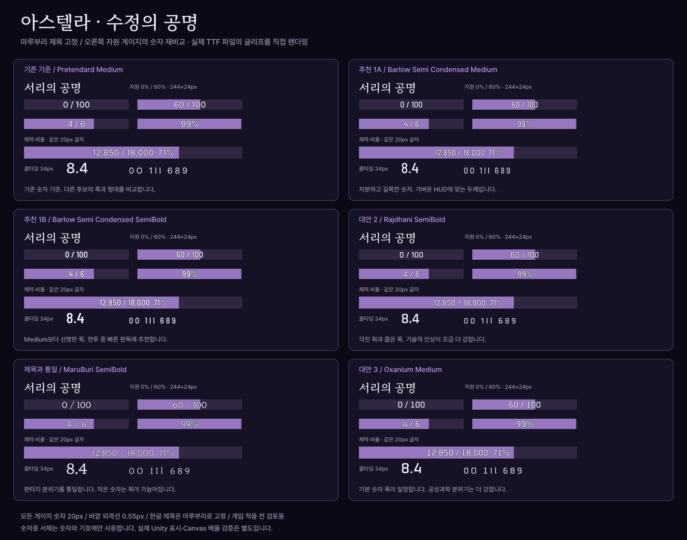

# 마루부리 확정과 게이지 숫자 재비교 — 2026-11-16

**후속 선택:** 사용자가 대안 3 Oxanium Medium을 선택해 숫자에 적용했다. [적용 기록](OXANIUM_MAIN_APPLY_2026-11-16.md)과 [크기별 아웃라인 대안](OXANIUM_OUTLINE_VARIANTS_2026-11-16.md)을 확인한다. 아래 추천·비교는 선택 전의 이력이다.

사용자는 **제목·보스명에 마루부리**를 선택했다. 원본 Unity에서 제목 서체와 아웃라인을 적용했다. [실제 적용·Play 검사 기록](MARUBURI_MAIN_APPLY_2026-11-16.md)을 참고한다. 이 문서는 오른쪽 게이지 숫자를 다시 고르기 위한 조사다. **숫자 후보는 아직 선택·적용하지 않았다.** 이전 [첫 폰트 비교](PRISM_FONT_RECOMMENDATION_2026-11-16.md)는 당시 이력으로 보존한다.

## 숫자 추천

**Barlow Semi Condensed SemiBold를 1순위로 추천한다.** 비교 이미지의 20px 숫자에서는 Medium보다 획이 선명하고, 좁은 폭과 차분한 모양이 마루부리 제목을 받쳐 준다. 이는 실제 시안을 확인한 디자인 판단이며 Unity Play에서 확정한 결과는 아니다.

| 후보 | 판단 |
| --- | --- |
| Barlow Semi Condensed SemiBold | 선명하고 길쭉한 숫자. 전투 자원과 쿨타임의 1순위 |
| Barlow Semi Condensed Medium | 더 가벼운 대안. 얇은 표시를 선호할 때 비교 |
| Rajdhani SemiBold | 각진 획과 좁은 폭. 기술적인 인상이 더 강함 |
| Oxanium Medium | 기본 숫자 폭이 일정하지만 공상과학 인상도 강함 |
| 마루부리 SemiBold 자체 숫자 | 제목과 분위기가 이어지지만 작은 숫자의 가는 획은 확인 필요 |

기존 Pretendard Medium을 기준으로 함께 표시했다. 각 카드의 제목은 마루부리로 고정했다. 자원 게이지는 **244×24px, 숫자 20px**, 짙은 남보라 `#131022` 외곽선은 시안 출력 기준 바깥으로 **0.55px**다. `0 / 100`, `60 / 100`, `4 / 6`, `99%`와 큰 HP 값·34px 쿨타임을 비교했다. 색·크기·문구·트랙 폭은 후보마다 동일하다. 이 수치를 Unity Outline의 effectDistance에 그대로 대입한 것은 아니다.

## 상업적 무료 사용과 출처

마루부리와 아래 숫자 후보는 **상업용 게임에 폰트를 포함하고 판매·배포할 수 있는 OFL 1.1**이다. 폰트 비용이나 로열티를 요구하는 라이선스가 아니다. 배포본에 각 저작권 고지와 라이선스 전문을 포함해야 하며, 폰트 파일 자체를 단독 상품으로 판매해서는 안 된다. 수정본은 해당 라이선스의 이름·재배포 조건을 따른다.

| 서체 | 공식 출처·사용한 정적 파일 | 공식 라이선스 |
| --- | --- | --- |
| 마루부리 | [네이버 소개](https://hangeul.naver.com/font/maru), [SemiBold TTF](https://hangeul.pstatic.net/0/hangeul/2023/fonts/MaruBuri-SemiBold.ttf) | [MaruBuri를 명시한 네이버 OFL 전문](https://help.naver.com/service/30016/contents/18088?osType=PC&lang=ko) |
| Barlow Semi Condensed | [제작자](https://github.com/jpt/barlow), [SemiBold TTF](https://raw.githubusercontent.com/google/fonts/main/ofl/barlowsemicondensed/BarlowSemiCondensed-SemiBold.ttf), [Medium TTF](https://raw.githubusercontent.com/google/fonts/main/ofl/barlowsemicondensed/BarlowSemiCondensed-Medium.ttf) | [공식 배포본 OFL](https://raw.githubusercontent.com/google/fonts/main/ofl/barlowsemicondensed/OFL.txt) |
| Rajdhani | [제작자](https://github.com/itfoundry/rajdhani), [SemiBold TTF](https://raw.githubusercontent.com/google/fonts/main/ofl/rajdhani/Rajdhani-SemiBold.ttf) | [공식 배포본 OFL](https://raw.githubusercontent.com/google/fonts/main/ofl/rajdhani/OFL.txt) |
| Oxanium | [제작자](https://github.com/sevmeyer/oxanium), [Medium TTF](https://raw.githubusercontent.com/sevmeyer/oxanium/master/fonts/ttf/Oxanium-Medium.ttf) | [제작자 OFL](https://raw.githubusercontent.com/sevmeyer/oxanium/master/OFL.txt) |

Barlow·Rajdhani·Oxanium은 이번에 확인한 라이선스 헤더에 별도 Reserved Font Name 선언이 없었다. 마루부리의 조건은 네이버 공식 전문을 기준으로 삼는다. 숫자 후보 OFL 복사본도 [증거 폴더](evidence/maruburi-number-20261116/)에 보존했다.

## 실제 파일 검사와 한계

2026-11-16 공식 경로에서 정적 TTF를 다운로드했다. [검증 JSON](evidence/maruburi-number-20261116/numeric-font-verification.json)에 실제 family·버전 문자열·크기·SHA256·샘플 폭과 숫자 폭 동일 여부를 기록했다. Barlow는 내부 버전 1.408, Rajdhani는 1.201, Oxanium은 2.000이다. WPF `GlyphTypeface`·`GlyphRun`에 실제 파일의 glyph index를 지정했으며 대체 폰트는 사용하지 않았다. 숫자와 필요한 기호 `0123456789.,/%+ OIl`을 명시적으로 검사했다.

Barlow와 Rajdhani의 기본 숫자 advance는 모두 같지 않다. 이번 시안은 별도 OpenType tabular 기능을 켜지 않았다. 값이 달라져도 자리를 고정하려면 실제 Unity 텍스트 정렬·필드 폭도 함께 확인해야 한다. 숫자 전용 서체를 한글 이름과 문장에 대체 적용하지 않는다.

숫자 폰트 바이너리는 저장소나 Assets에 넣지 않고 `C:/Astella/maruburi-number-evidence-20261116/`에 보관했다. 재생성 스크립트는 같은 폴더의 `render-numeric-specimen.ps1`이다. 이 조사는 글리프 비교이며 후보 숫자의 Unity import·화면 표시·빌드·실제 전투 가독성 검증은 수행하지 않았다. 마루부리 메인 적용 결과는 담당 작업의 별도 검증 기록을 따른다.
