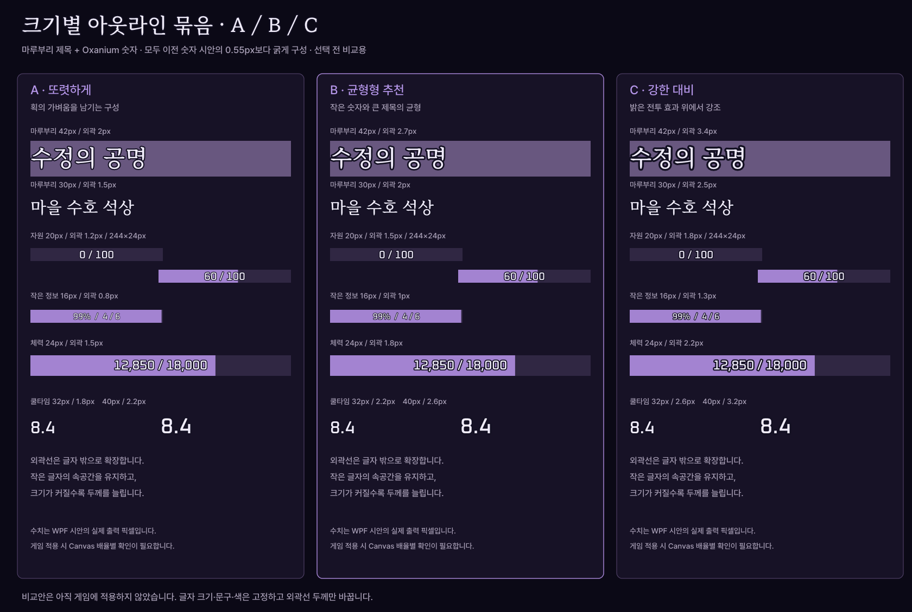

# Oxanium 확정과 크기별 아웃라인 대안 — 2026-11-16

사용자가 숫자 서체로 이전 비교의 **대안 3, Oxanium Medium**을 선택했다. 제목 서체는 마루부리 SemiBold를 유지한다. 이 문서는 더 두꺼운 아웃라인을 고르기 위한 **비교 시안**이다. 아래 A/B/C 아웃라인 묶음을 게임에 적용한 결과는 아니다. [숫자 서체의 메인 적용·실제 Play 검사](OXANIUM_MAIN_APPLY_2026-11-16.md)는 별도 기록을 따른다.

## 크기별 선택안

작은 글자는 속공간을 남기고 큰 제목·쿨타임일수록 외곽선을 늘리는 **B 균형형**을 추천한다. 이는 실제 폰트 파일로 렌더링한 아래 시안을 확인한 디자인 판단이다.

| 용도·실제 글자 크기 | A · 또렷하게 | B · 균형형 추천 | C · 강한 대비 |
| --- | ---: | ---: | ---: |
| Oxanium 작은 정보 16px | 0.8px | 1.0px | 1.3px |
| Oxanium 자원 수치 20px | 1.2px | 1.5px | 1.8px |
| Oxanium 체력 수치 24px | 1.5px | 1.8px | 2.2px |
| Oxanium 쿨타임 32px | 1.8px | 2.2px | 2.6px |
| Oxanium 큰 쿨타임 40px | 2.2px | 2.6px | 3.2px |
| 마루부리 보스명 30px | 1.5px | 2.0px | 2.5px |
| 마루부리 제목 42px | 2.0px | 2.7px | 3.4px |

표의 수치는 글자 **바깥으로 보이는 남보라 `#131022` 선의 두께**다. 숫자에는 이전 시안의 0.55px보다 모두 굵은 선을 사용했다. 제목 42px는 밝은 배경, 보스명 30px는 어두운 배경으로 함께 보여 경계가 얼마나 강조되는지 비교한다. `0 / 100`, `60 / 100`, `99%`, `4 / 6`, 큰 HP 값과 `8.4`를 사용했다.

자원 게이지는 실제 폭·높이 **244×24px**다. 큰 체력 수치와 쿨타임에는 각각 별도 표시 영역을 사용했다. 글자를 늘이거나 이미지를 확대해 큰 크기처럼 보이게 하지 않았다.

## 같은 두께를 크기마다 비교

[고정 두께 비교표](evidence/oxanium-outline-20261116/oxanium-outline-size-grid-20261116.png)는 Oxanium 16·20·24·32·40px에 이전 시안 0.55px와 고정 두께 1.0·1.5·2.0px를 적용한다. 위 A/B/C는 크기에 따라 두께를 바꾸는 묶음이며, 이 고정 두께 표와 구분한다. PNG를 100%로 열면 실제 출력 픽셀 크기로 볼 수 있다.

## 제작·검증 범위

- 실제 정적 Oxanium Medium, 마루부리 SemiBold의 `GlyphTypeface`·`GlyphRun` glyph index로 렌더링했다. 필요한 문자가 없으면 실패하도록 했으며 OS 대체 폰트를 사용하지 않았다.
- WPF 96 DPI로 원본 1680×1140 비교표와 1680×1130 묶음 시안을 생성했다. 직접 두 이미지를 열어 크기·잘림·아웃라인 표시를 확인했다.
- `BuildGeometry()`에 요청 두께의 두 배인 Pen으로 선을 먼저 그리고 글자 면을 다시 채워, 바깥쪽으로 요청 두께가 보이도록 했다. 글리프 파일을 수정하거나 외곽선을 구워 넣지 않았다.
- [규격·폰트 지문 JSON](evidence/oxanium-outline-20261116/outline-variant-specification.json)에 파일 SHA256, 실제 크기와 두께를 기록했다. 재생성 스크립트는 외부 `C:/Astella/oxanium-outline-evidence-20261116/render-outline-variants.ps1`이다.

**시안의 출력 픽셀 두께는 Unity Outline의 effectDistance와 같은 값이 아니다.** 실제 적용 시 Canvas 배율과 글자 크기에 맞춰 조정하고 작은 숫자의 속공간, 동적인 값 변화, 밝은 효과 위 경계를 별도로 확인해야 한다. 이번 비교 제작은 Assets·씬·프리팹을 수정하지 않았다. 아웃라인 묶음의 Unity 적용·빌드 결과는 검증하지 않았다.

폰트의 공식 출처와 상업적 사용 조건은 [앞선 숫자 서체·라이선스 조사](MARUBURI_NUMERIC_FONT_REVIEW_2026-11-16.md)에 보존했다.
