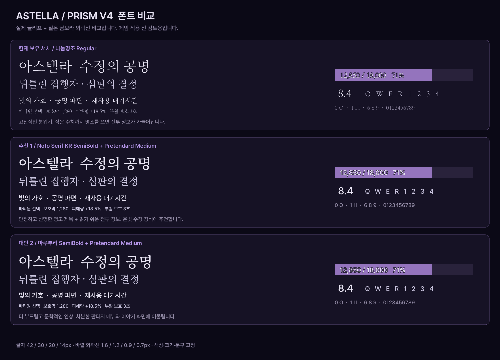

# Prism V4 폰트 추천 — 2026-11-16

**제목·보스명은 Noto Serif KR SemiBold, 전투 정보는 Pretendard Medium을 추천한다.** 은빛·보랏빛 수정 장식에는 선명한 명조 제목을 사용하고 HP·자원·쿨타임·단축키·설명은 읽기 쉬운 산세리프로 나누는 구성이다. 시각적 적합성은 아래 비교 이미지를 확인한 디자인 판단이다.

사용자의 요청은 폰트 찾기다. **게임 폰트 교체, Unity import, prefab·theme 변경은 수행하지 않았다.** 폰트 바이너리는 저장소에 추가하지 않았으며 `C:/Astella/training-font-evidence-20261116/`에만 내려받았다.

## 추천과 대안

| 구분 | 제목·보스명 | 본문·수치 | 선택 이유 |
| --- | --- | --- | --- |
| 추천 1 | Noto Serif KR SemiBold | Pretendard Medium, 강조 SemiBold | 단정하고 차가운 판타지 인상. 수정 장식과 제목 획의 선명함이 잘 맞는다. |
| 대안 2 | 마루부리 SemiBold | Pretendard Medium, 강조 SemiBold | 더 부드럽고 문학적인 인상. 차분한 메뉴·이야기 화면에 어울린다. |

실제 적용 시 시작점은 제목 36–48px, 보스명 24–30px, 전투 정보 18–20px다. 기존 Canvas 배율과 각 텍스트 영역에서 줄바꿈·잘림·수치 가독성을 따로 확인해야 한다. 이 크기는 적용·Play 검증을 마친 수치가 아니다.

## 외곽선 방향 — 사용자 요청 반영

밝은 은빛 글자에 **짙은 남보라 `#131022` 외곽선**을 더한다. 밝은 보스 효과·보라색 게이지 위에서도 글자 경계를 유지하는 방향이다. 비교 이미지의 모든 후보에 같은 규칙을 적용했고 게이지 채움 배경을 더 밝게 하여 경계를 확인할 수 있게 했다.

| 비교 글자 크기 | 글자 바깥으로 보이는 외곽선 두께 |
| --- | ---: |
| 제목 42px | 1.6px |
| 보스명 30px | 1.2px |
| 본문·수치 20px | 0.9px |
| 작은 정보 14px | 0.7px |

이 수치는 WPF 시안의 출력 픽셀 기준이다. 중심선을 따라 그리는 Pen의 전체 두께는 표의 두 배로 설정하고 외곽선을 먼저 그린 뒤 글자 면을 다시 채워, 안쪽 선이 글자 획을 잠식하지 않게 했다. Unity의 효과 파라미터에 그대로 대입한 값이 아니다.

폰트 파일 자체는 일반 서체를 유지한다. 실제 적용 시에는 프리팹의 [uGUI Outline 효과](https://docs.unity3d.com/Packages/com.unity.ugui@2.0/manual/script-Outline.html)로 조정하며 글리프에 외곽선을 굽지 않는다. 작은 글자에 과도한 굵기를 적용하거나 Shadow를 중복하고 큰 흐림 그림자를 추가하는 방식은 피한다. 외곽선을 포함한 Unity 표시와 Canvas 배율별 두께는 아직 검증하지 않았다.

비교 이미지의 첫 행은 저장소에 보유한 `Assets/UI/AstellaOrnate/Fonts/NanumMyeongjo-Regular.ttf`를 기준으로 삼았다. 현재 게임의 모든 텍스트가 이 폰트를 사용한다는 뜻은 아니다. 같은 문구·색상·크기로 제목 42px, 보스명 30px, 본문 20px, 작은 정보 14px와 HP·쿨타임·단축키를 비교했다.

## 출처·라이선스

- **Noto Serif KR:** [공식 다운로드 안내](https://github.com/notofonts/noto-cjk/blob/main/Serif/README.md), [사용한 정적 SemiBold OTF](https://github.com/notofonts/noto-cjk/blob/main/Serif/SubsetOTF/KR/NotoSerifKR-SemiBold.otf), [공식 OFL 1.1](https://github.com/notofonts/noto-cjk/blob/main/Serif/LICENSE).
- **Pretendard:** [제작자 공식 저장소](https://github.com/orioncactus/pretendard), [v1.3.9 배포](https://github.com/orioncactus/pretendard/releases/tag/v1.3.9), [정적 TTF 경로](https://github.com/orioncactus/pretendard/tree/v1.3.9/packages/pretendard/dist/public/static/alternative), [공식 OFL 1.1](https://github.com/orioncactus/pretendard/blob/main/LICENSE). 한글판 Pretendard를 사용했으며 라틴 전용 Std가 아니다.
- **마루부리:** [네이버 공식 소개·다운로드](https://hangeul.naver.com/font/maru), [사용한 정적 SemiBold TTF](https://hangeul.pstatic.net/0/hangeul/2023/fonts/MaruBuri-SemiBold.ttf), [MaruBuri를 명시한 네이버 공식 OFL 1.1 전문](https://help.naver.com/service/30016/contents/18088?osType=PC&lang=ko).

세 폰트 모두 공식 OFL 1.1에 따라 상업용 게임에 포함·배포할 수 있다. 배포본에는 각 폰트의 저작권 고지와 라이선스 전문을 포함해야 하며 폰트 자체의 단독 판매는 허용되지 않는다. 수정본에는 예약된 폰트 이름에 관한 조건도 적용된다. 위 각 공식 라이선스를 배포 시 기준으로 삼는다.

## 파일 검증과 미검증 범위

2026-11-16에 공식 배포 경로에서 받은 파일을 검사했다. 버전은 파일의 OpenType `name` 테이블 ID 5에서 읽었다. Pretendard 배포 버전 `v1.3.9`와 내부 버전 `1.309`는 표기 체계가 다르다.

| 비교에 사용한 후보 파일 | 내부 버전 | 파일 크기 | 한글 완성형 U+AC00–U+D7A3 |
| --- | --- | ---: | ---: |
| NotoSerifKR-SemiBold.otf | 2.003 | 7,610,748 bytes | 11,172 / 11,172 |
| MaruBuri-SemiBold.ttf | 2.000 | 8,111,880 bytes | 11,172 / 11,172 |
| Pretendard-Medium.ttf | 1.309 | 2,701,192 bytes | 11,172 / 11,172 |
| Pretendard-SemiBold.ttf | 1.309 | 2,671,468 bytes | 11,172 / 11,172 |

[검증 JSON](evidence/training-font-20261116/font-file-verification.json)에 실제 family 이름, 파일 크기, 완성형 한글 수와 전체 SHA256을 기록했다. 다운로드한 파일의 SHA256이 기록값과 일치하는지 재확인했다. 이 지문은 비교에 사용한 파일을 식별하며 제작자의 서명 검증을 뜻하지 않는다.

이미지는 Windows WPF `GlyphTypeface`·`GlyphRun`으로 실제 파일의 glyph index와 advance width를 지정하고 `BuildGeometry()`의 도형에 외곽선·글자 면을 차례로 그렸다. OS 대체 폰트를 사용하지 않았으며 비교 문구에 없는 글리프가 있으면 실패하도록 했다. 외곽선이 반영된 1500×1080 PNG를 직접 열어 확인했다. 이 결과는 완성형 한글과 비교 문구의 검증이며 모든 유니코드 문자의 지원을 보장하지 않는다.

Unity는 [공식 문서상 TTF·OTF를 지원](https://docs.unity.cn/Manual/class-Font.html)하므로 기존 uGUI Text에는 정적 TTF·OTF 파일을 사용하는 방향이다. **이번 후보의 Unity import, 런타임 한글 표시, 해상도별 가독성·줄바꿈 및 빌드 포함 결과는 아직 검증하지 않았다.**
